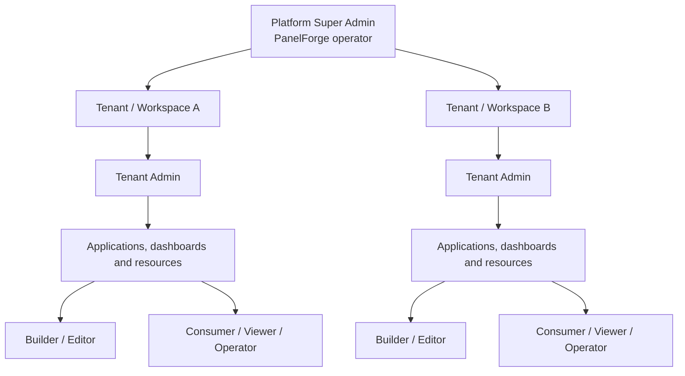

# PanelForge authorization and role model

## Purpose

PanelForge is a multi-tenant platform for building and operating internal applications. It has two distinct security planes:

1. **Platform administration** — operating the PanelForge SaaS.
2. **Tenant/application administration** — building applications and deciding which tenant users can see or do what.

A role in one plane must never silently grant authority in the other.

## Target role hierarchy

The Super Admin relationship to tenants is platform oversight, not ordinary tenant membership. Tenant A users cannot see Tenant B data or users.

## Role responsibilities

| Role | Scope | Intended capabilities |
|---|---|---|
| **Platform Super Admin** | Entire PanelForge platform | Manage tenant lifecycle, platform configuration, operational health and support access. Exceptional tenant-data access must be justified, time-bound and audited. |
| **Tenant Owner** | One tenant/workspace | Own the tenant, manage tenant admins and recover tenant administration. |
| **Tenant Admin** | One tenant/workspace | Create applications, manage resources/settings, invite users and assign only roles within their delegation boundary. |
| **Builder / Editor** | Assigned application(s) | Build and edit permitted application drafts and configure components/data bindings. No tenant administration by default. |
| **Consumer / Viewer** | Assigned application(s) | View permitted published apps, pages, records and fields. No builder or resource-schema access by default. |
| **Operator / Contributor** | Assigned application/resource scope | Optional narrow role for permitted record operations without dashboard design or tenant administration. |

Tenant Owner/Admin are workspace-administration roles. Builder, Consumer and Operator are application capabilities. A person may hold multiple explicitly assigned capabilities; permissions are resolved by policy, not inferred from navigation visibility.

## Permission layers

Authorization is enforced server-side across all applicable layers:

1. **Platform:** platform administration and support operations.
2. **Tenant:** membership, tenant settings, invitations and application ownership.
3. **Application:** discover, view, build, edit, publish and administer an application.
4. **Resource/action:** create, read, update, delete, export and aggregate.
5. **Field:** read, write, hide or redact specific fields.
6. **Record scope:** all, assigned, own or policy-defined records.

A user may be allowed to view a dashboard but denied a sensitive field or record. Dashboard visibility must never bypass underlying data permissions.

## Suggested permission matrix

This is a target baseline, not a claim that every permission is implemented.

| Capability | Super Admin | Tenant Owner | Tenant Admin | Builder/Editor | Consumer/Viewer |
|---|---:|---:|---:|---:|---:|
| Manage PanelForge tenants | Yes | No | No | No | No |
| Manage platform settings | Yes | No | No | No | No |
| Manage tenant members/invitations | Support policy | Yes | Yes, within grant | No | No |
| Assign tenant Owner/Admin | Platform policy | Owner only | No by default | No | No |
| Create applications/resources | Support policy | Yes | Yes | Optional grant | No |
| Build/edit application drafts | Support policy | Yes | Yes | Yes, assigned apps | No |
| Publish applications | Support policy | Yes | If granted | If granted | No |
| View published application | Support policy | By app policy | By app policy | By app policy | Yes, if assigned |
| Read records | By support policy | By data policy | By data policy | By data policy | Explicit read grant |
| Mutate records | By support policy | By data policy | By data policy | Explicit action grant | No by default |

Super Admin is not a blanket entitlement to silently inspect customer data. Platform support access requires justification, audit and least privilege.

## User and role administration flow

1. A Tenant Owner/Admin invites a person to the workspace.
2. The invitee accepts and becomes an active tenant member.
3. The administrator assigns application access and an allowed role/capability.
4. The policy engine resolves effective permissions for each request.
5. Revoking membership or application access must immediately affect subsequent API requests.

A Tenant Admin cannot create a platform Super Admin, grant themselves platform access or assign roles above their delegation boundary. Invitation acceptance, custom role creation and granular permissions remain follow-up implementation work.

## Non-negotiable security rules

- Deny by default.
- Resolve identity and tenant membership server-side on every protected request.
- Never trust tenant IDs, roles, resource IDs or permission lists supplied by the browser.
- Enforce authorization in API guards/domain services and data queries, not only navigation.
- Apply the same policy to tables, forms, exports, metrics and charts.
- Re-check permissions at runtime so revocation takes effect without republishing.
- Audit role changes, invitations, platform support access, publishing and sensitive mutations.
- Never let tenant-level roles cross tenant boundaries.

## Current implementation status

**Implemented today**
- Platform user identity and tenant membership.
- Tenant-scoped roles: `OWNER`, `ADMIN` and `MEMBER`.
- Workspace member/invitation management foundation.
- Application creation and builder draft writes restricted to tenant owners/admins.
- Tenant/application scoping for resources and dynamic records.

**Not yet implemented**
- Platform Super Admin role and platform administration console.
- Application-level Builder/Editor and Consumer/Viewer assignments.
- Custom roles and permission editor.
- Per-resource CRUD grants, field restrictions and record scopes.
- Consumer-facing published runtime.
- Complete audit event pipeline for permission/support operations.

Do not describe the target model as shipped until implemented and covered by negative authorization tests.

## Delivery sequence

- **Phase 4.6:** Builder validation and editing quality; no expansion of role privileges.
- **Phase 5:** Runtime rendering and API-enforced data operations.
- **Phase 6:** Permission engine and application-level Builder/Editor and Consumer/Viewer roles.
- **Phase 7:** Publishing, immutable snapshots and consumer access.
- **Production hardening:** Super Admin console, audited support workflows, audit retention and security review.

## Related documents

- [Security and tenant isolation](security-and-tenant-isolation.md)
- [Data model and storage](../02-database/data-model-and-storage.md)
- [Builder help and tutorials](../04-features/builder-help.md)
- [Project roadmap](../07-project-management/roadmap.md)
