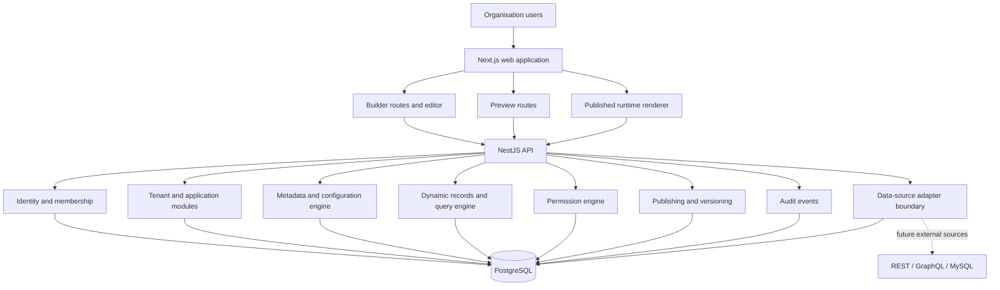
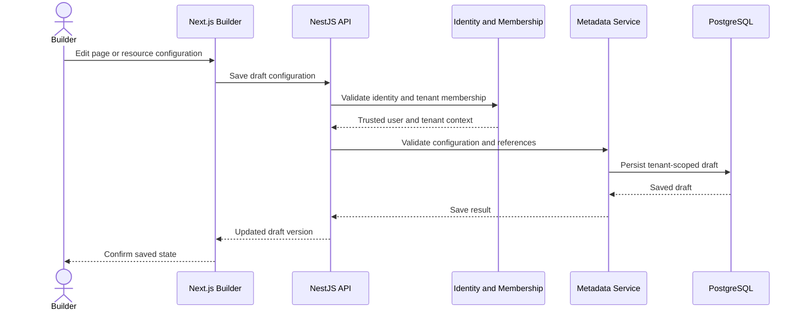
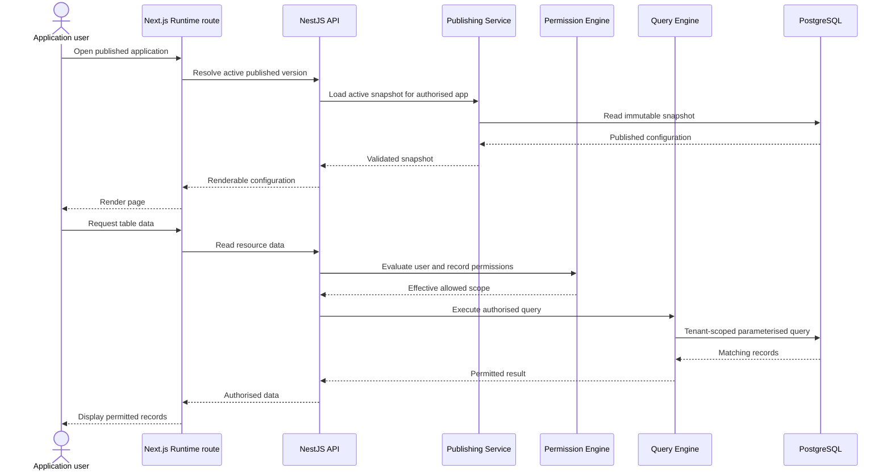
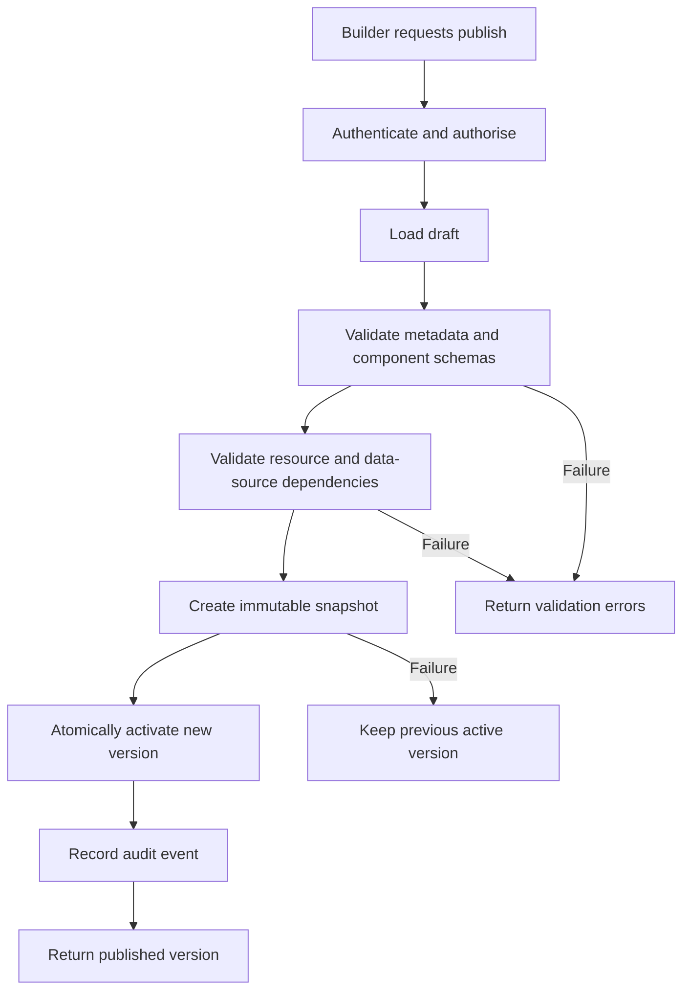

# PanelForge system architecture

## 1. Purpose

This document describes the proposed high-level architecture for the PanelForge MVP: its deployable applications, internal modules, core engines, trust boundaries and principal data flows.

The architecture is a **modular monolith**. It separates responsibilities through explicit module and package boundaries without introducing a distributed system before the product needs one.

This document is **Proposed** and should be reviewed alongside the [technology stack](technology-stack.md) and [MVP scope](../00-product/mvp-scope.md).

## 2. Architecture goals

1. Support multiple organisations with strict tenant isolation.
2. Allow builders to create applications through declarative metadata rather than custom code.
3. Render published applications from validated, immutable configuration snapshots.
4. Enforce authentication, tenant membership and permissions in trusted backend code.
5. Support managed PostgreSQL data first and add external data-source adapters later.
6. Keep the MVP easy to run, test, debug and deploy.
7. Preserve clear boundaries so individual capabilities can be extracted later if scale or operational needs justify it.

## 3. Architectural style

PanelForge will start as a modular monolith with two deployable applications:

- **Web application:** one Next.js deployment containing the builder, preview and published runtime routes.
- **API application:** one NestJS deployment containing domain modules and the platform's trusted business logic.

PostgreSQL is the primary persistent store. Additional infrastructure such as Redis, a worker process and object storage is introduced when a concrete feature requires it.

A module is not a microservice. Modules share a deployment and can participate in database transactions, but must still have clear ownership and explicit interfaces.

## 4. High-level component diagram



The diagram represents logical responsibilities, not a requirement to deploy each box independently.

## 5. Deployable application boundaries

### 5.1 Web application — Next.js

The web application owns user-facing navigation and presentation:

- Sign-in and organisation onboarding screens.
- Organisation and application management.
- Visual builder and component configuration panels.
- Draft preview.
- Published application routes.
- Client-side state and API integration.

The web application does **not** own security decisions. It may hide unavailable actions for usability, but the API must independently enforce every access decision.

Suggested route areas:

```text
/sign-in
/organisations
/organisations/[organisationSlug]/applications
/organisations/[organisationSlug]/applications/[appId]/builder
/preview/[appId]
/ app/[applicationSlug]/*
```

The route naming is illustrative and may change during implementation. The published route must resolve the correct tenant and application from trusted server-side context.

### 5.2 API application — NestJS

The API owns:

- Identity-token validation integration and user resolution.
- Tenant membership and application access.
- Metadata validation and persistence.
- Dynamic data reads and writes.
- Permission evaluation.
- Publish validation and snapshot creation.
- Audit event creation.
- Data-source credential handling and connector execution.

The API exposes versioned REST endpoints under `/api/v1`. It validates request DTOs, resolves the authenticated principal and applies tenant and permission checks before accessing protected data.

### 5.3 Runtime renderer — shared package

The runtime renderer is initially a package used by the Next.js web application. It is not a separate server or service.

Its responsibilities:

1. Receive a validated published application configuration.
2. Resolve page and component definitions.
3. Map component type identifiers to approved registry entries.
4. Render tables, forms, navigation and dashboard widgets.
5. Request data through the API.
6. Present loading, empty, validation and error states.

It must not evaluate arbitrary JavaScript contained in configuration. Unknown component types or unsupported configuration versions must fail safely with a controlled error state.

## 6. Backend module boundaries

| Module | Owns | Must not own |
|---|---|---|
| Identity and membership | User identity, organisation membership, invitation lifecycle | Customer record queries |
| Tenants and applications | Organisation and application lifecycle | Rendering React components |
| Data sources | Connector definitions, safe credential references, connection tests | Frontend builder state |
| Resources and metadata | Resource schemas, fields, relationships and schema versions | UI-specific drag state |
| Configuration | Pages, layouts, views, widgets and draft configuration | Direct arbitrary code execution |
| Dynamic records | Managed record CRUD and query validation | Tenant identity from untrusted request fields |
| Permissions | Role assignments and policy evaluation | UI-only visibility rules |
| Publishing | Validation, immutable snapshots, active version and rollback | Mutating an existing published snapshot |
| Audit | Security- and product-relevant event records | Deciding whether an action is authorised |

Modules should expose application services and domain types rather than allowing unrelated modules to reach into each other's internal repositories.

## 7. Core engine responsibilities

### 7.1 Metadata engine

The metadata engine defines what an application contains:

- Resources and fields.
- Field types, defaults and validation constraints.
- Relationships between resources.
- Pages, views, layouts and component configurations.
- Schema and configuration versions.

It validates metadata before it is persisted or published. Stable field identifiers should be used so that renaming a field does not silently break stored records or saved views.

### 7.2 Component registry and renderer

The component registry is an allowlist of supported component types. Each entry defines:

- A stable component type identifier.
- A configuration schema.
- Supported properties and defaults.
- A renderer implementation.
- Data requirements and permitted actions.

The renderer resolves configuration through this registry. Configuration is data, not executable application code.

### 7.3 Dynamic data and query engine

The query engine translates validated resource and view requests into authorised data operations.

For the first release, managed records live in PostgreSQL. The engine must:

- Resolve the requested resource within the authenticated tenant and application.
- Validate filters, sorting, pagination and selected fields.
- Apply record-level and field-level policy constraints.
- Execute parameterised database operations.
- Return only fields and records the caller may access.

Do not accept raw SQL from the browser or concatenate user input into SQL statements.

### 7.4 Permission engine

The permission engine evaluates access using trusted server-side context:

- Authenticated user.
- Tenant membership.
- Application membership or assignment.
- Role and permission assignments.
- Resource and action.
- Field restrictions.
- Record-level scope.

The same policy rules must apply to reads, creates, updates, deletes and action execution. Frontend visibility is a usability layer only.

### 7.5 Publishing engine

Publishing turns a validated draft into an immutable, versioned snapshot.

A publish operation should:

1. Load the current draft under the authenticated tenant and application.
2. Validate configuration schemas and referenced resources.
3. Validate that component types and properties are supported.
4. Validate required permissions and data-source dependencies.
5. Create a new immutable snapshot and version.
6. Atomically update the application's active published version.
7. Preserve previous snapshots for rollback and audit.

If validation or snapshot creation fails, the currently active published version must remain unchanged. Published snapshots are never edited in place.

## 8. Principal data flows

### 8.1 Builder save flow



The browser submits the intended application and configuration. The API derives the tenant from authenticated membership and verifies access to that application; a client-supplied tenant ID is never treated as authority.

### 8.2 Published runtime read flow



The runtime must not treat a published snapshot as an authorisation grant. Current user permissions are evaluated on every protected data request.

### 8.3 Publish flow



The active version changes only after all publish validation and snapshot persistence steps succeed.

## 9. Trust boundaries and security invariants

These rules are architectural requirements, not optional frontend conventions:

1. **Identity:** API requests must be authenticated using a validated identity token or trusted server-side session integration.
2. **Tenant context:** derive tenant scope from the authenticated user's membership; never trust a tenant ID supplied by the client.
3. **Application access:** verify that the principal can access the requested application within that tenant.
4. **Backend authorisation:** enforce resource, action, field and record restrictions on every protected operation.
5. **Query safety:** use validated query definitions and parameterised operations; do not expose arbitrary SQL execution.
6. **Configuration safety:** render only allowlisted component types and validated configuration; do not execute arbitrary customer-supplied JavaScript.
7. **Secrets:** never return connector credentials to the browser; store secret references or encrypted credentials using an appropriate secrets-management design.
8. **Published configuration:** published snapshots are immutable; failed publishing must not replace the active version.
9. **Auditability:** record important security-sensitive and administrative changes with tenant and actor context.
10. **Testing:** add negative tests for cross-tenant access and unauthorised resource, field and record operations.

## 10. Persistence and tenant ownership

PostgreSQL is shared by tenants in the MVP. Tenant-owned entities must have explicit tenant ownership or an enforceable ownership path through their parent records.

Use foreign keys, uniqueness constraints and indexes to protect data integrity. Consider composite constraints that include tenant identifiers where they prevent accidental cross-tenant relationships.

The API's repository and query layer must require tenant context for tenant-owned data operations. PostgreSQL row-level security may be added as defence in depth, but it does not replace application-level authorisation or tests.

## 11. Initial monorepo layout

The following is the intended logical layout. Create packages as their responsibilities become real; do not create empty packages just to match the diagram.

```text
apps/
  web/                         # Next.js builder, preview and runtime routes
  api/                         # NestJS modular monolith

packages/
  ui/                          # Shared design-system components
  component-registry/          # Approved runtime component definitions
  runtime-renderer/            # Metadata-driven rendering
  metadata-engine/             # Metadata types and validation
  permissions/                 # Shared policy types/helpers
  validation/                  # Shared schemas where appropriate
  shared-types/                # Stable cross-app contracts
  database/                    # Prisma schema and database utilities

docs/
  00-product/
  01-architecture/
  02-database/
  03-engines/
  04-features/
  05-api/
  06-operations/
  07-project-management/
  adr/
```

Potential future additions:

- `apps/worker` for asynchronous jobs.
- `packages/data-source-adapters/` for connector implementations.
- A separately deployed runtime application if operational requirements justify it.

## 12. Failure handling and resilience

- API errors must use consistent response formats and avoid leaking internal details.
- A failed draft save must not corrupt the last successfully saved draft.
- A failed publish must preserve the active published snapshot.
- A connector timeout or outage must return a controlled error and must not bypass permissions.
- Unknown metadata versions and unsupported component types must fail closed.
- Retries must be limited to operations that are safe to retry; mutating operations should use idempotency protections where needed.

## 13. Architecture decisions deferred

| Topic | Current direction | Revisit when |
|---|---|---|
| Identity provider | OIDC-compatible provider; exact provider pending | Before auth implementation |
| Hosting topology | Web and API as separate deployables | Infrastructure design |
| Background jobs | No worker initially | First long-running or scheduled job |
| Redis | Deferred | Queue, cache or coordination requirement exists |
| Runtime deployment | Shared renderer in Next.js web app | Independent scaling or release cadence is needed |
| PostgreSQL row-level security | Evaluate as defence in depth | Database access patterns are established |
| External data sources | Adapter boundary; PostgreSQL first | REST connector implementation begins |

## 14. Related documents

- [Product definition](../00-product/product-definition.md)
- [MVP scope](../00-product/mvp-scope.md)
- [Technology stack](technology-stack.md)
- [Documentation conventions](../documentation-conventions.md)
- [ADR index](../adr/README.md)

---

## Change history

| Version | Date | Change |
|---|---|---|
| 0.1 | 2026-11-10 | Initial proposed system architecture for the PanelForge MVP |
