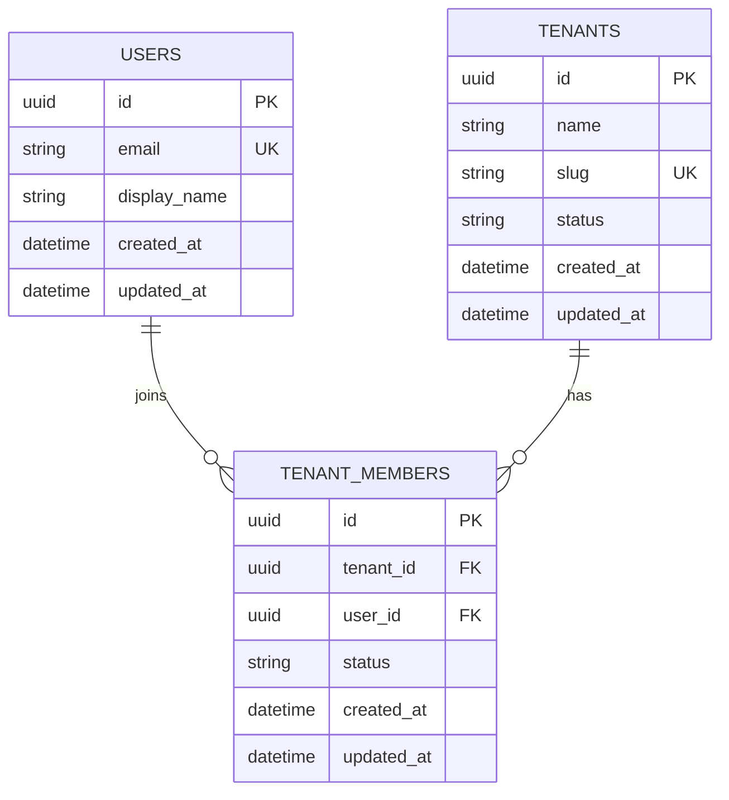
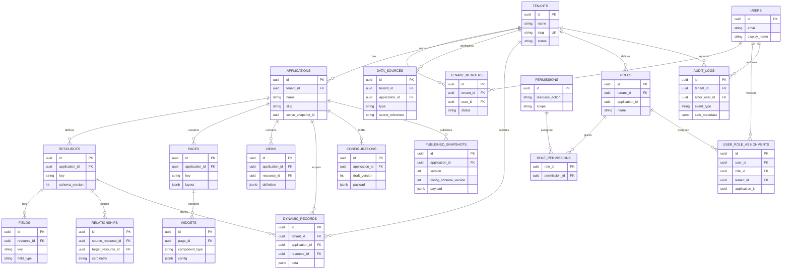

# PanelForge logical ERD

This is the logical MVP model. Exact Prisma models, composite foreign keys, delete rules and migrations are finalised during implementation review.

## Initial implementation slice

The first database migration is intentionally limited to platform identity and tenancy. The Prisma schema defines these relationships:

The Prisma schema and generated migration are the implementation source for this initial slice. The broader logical model below is a forward-looking MVP model; it is not a claim that all entities have already been implemented or migrated.

## Logical MVP model

## Integrity and uniqueness rules

- Membership unique on (tenant_id, user_id).
- Application slug unique within tenant.
- Resource key unique within application.
- Field key unique within resource.
- Snapshot version unique within application.
- Dynamic records carry tenant, application and resource scope; all ownership references must agree.
- Relationships connect resources in the same application.
- The active snapshot pointer references a snapshot in that application.
- Application-scoped roles and assignments must be tenant/application consistent.
- Audit records are tenant-scoped; actor may be nullable for system events.
- Index tenant/application/resource scope and frequently joined foreign keys.
- Use composite constraints where practical to prevent cross-tenant references.
- Avoid cascading deletion of audit history or published snapshots.

## Deliberately deferred

Workflow executions, API credentials, role inheritance, external schema caches and per-tenant physical tables are not required for the first migration.

## Related documents

- [Data model and storage](data-model-and-storage.md)
- [Security and tenant isolation](../01-architecture/security-and-tenant-isolation.md)

## Change history

| Version | Date | Change |
|---|---|---|
| 0.1 | 2026-11-10 | Initial logical ERD |
| 0.2 | 2026-11-10 | Add the initial identity and tenancy implementation slice |
