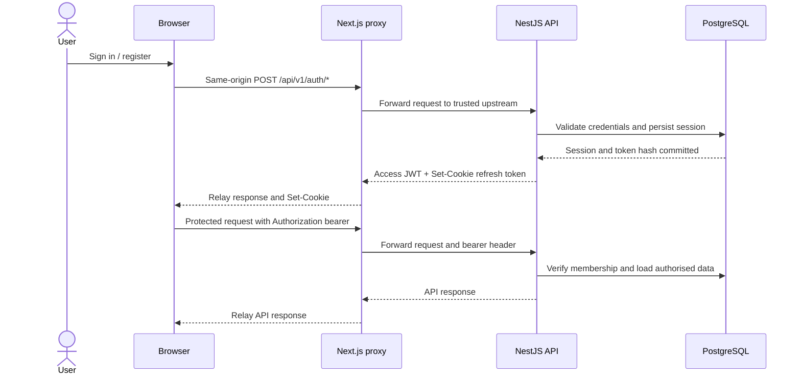

# ADR-008: Next.js same-origin proxy for browser API requests

- **Status:** Proposed
- **Date:** 2026-11-12
- **Related:** [System architecture](../01-architecture/system-architecture.md), [Security and tenant isolation](../01-architecture/security-and-tenant-isolation.md)

## Context

PanelForge has two separately deployable applications: a Next.js web application and a NestJS API. The browser needs to call the API while authentication uses a short-lived access JWT in memory and a refresh token in an HttpOnly cookie.

Calling a separately hosted API directly from the browser introduces cross-origin configuration and cookie constraints. We want to keep the API independently deployable without making browser authentication unnecessarily complex.

## Decision

Browser API calls use the Next.js origin and are forwarded by a controlled Next.js proxy to the configured NestJS API origin.

```text
Browser
  |
  | https://app.panelforge.example/api/v1/*
  v
Next.js deployment (same-origin proxy)
  |
  | private/trusted upstream request
  v
NestJS API deployment
  |
  v
PostgreSQL
```

## Why this option

1. **Simpler browser security model:** browser requests remain same-origin, reducing browser-facing CORS and cross-origin cookie configuration.
2. **HttpOnly refresh cookie:** the browser can send the refresh cookie without JavaScript reading it.
3. **Deployment independence:** NestJS remains a separately deployable and scalable API; the proxy does not move business logic into Next.js.
4. **Stable public API origin:** the browser need not know the API's internal hostname or deployment topology.
5. **Learning value:** this creates a concrete opportunity to study reverse proxies, forwarding headers, TLS termination, timeouts and gateway patterns.

## Alternatives considered

| Option | Benefits | Trade-offs | Decision |
|---|---|---|---|
| Direct browser-to-NestJS calls | Fewer application hops; simpler request path | Browser-facing CORS; cross-origin credential/cookie policy; exposes API hostname; more deployment-specific client configuration | Not selected for MVP |
| Next.js same-origin proxy | Same-origin browser traffic; HttpOnly cookie flow; stable browser endpoint; independent API | Extra hop; proxy code/configuration; timeout, body-size and header-forwarding concerns; Next.js becomes part of API availability path | **Selected** |
| Dedicated API gateway / ingress | Central routing, TLS, WAF, rate limits and observability | Extra infrastructure and operational complexity before MVP needs it | Revisit for production |
| Nginx reverse proxy | Powerful and educational routing/TLS/load-balancing layer | Another service/configuration to operate; does not remove the need to decide browser cookie topology | Post-MVP experiment |

## Request flow



## Security and operational requirements

- Upstream URL is configured server-side and allowlisted; never accept it from a request parameter/header.
- Forward only required headers. Do not blindly forward hop-by-hop headers.
- Forward cookies only to the trusted API upstream.
- Relay Set-Cookie correctly; test cookie Path, Domain, Secure, HttpOnly and SameSite attributes in deployed topology.
- Do not cache authenticated or personalised API responses.
- Do not log Authorization headers, Cookie headers, access tokens or refresh tokens.
- Enforce request-size and timeout limits.
- Preserve request correlation IDs and propagate a trusted request ID.
- Validate Origin and apply CSRF protection to cookie-authenticated state-changing operations.
- Do not rely on the proxy for authentication, authorisation or tenant isolation; NestJS independently enforces all of them.
- Test streaming, file uploads/downloads and large responses if/when introduced.

## Consequences

### Positive
- Browser uses one origin for web and API traffic.
- Refresh cookie is easier to operate without browser-facing cross-origin credentials.
- API hostname and internal deployment can change without changing browser API calls.

### Negative and risks
- One extra network hop adds latency and consumes Next.js capacity.
- Proxy bugs can break all browser API calls.
- Proxy and API availability become coupled for browser traffic.
- Deployment must correctly handle forwarded headers, TLS termination, cookie attributes and observability.

## Revisit criteria

Reassess when deploying behind Nginx, a cloud load balancer, API gateway or CDN; when API traffic outgrows the Next.js proxy; or when server-to-server clients require direct API access. The same-origin proxy is a browser transport choice, not a restriction on trusted server-to-server integration.
